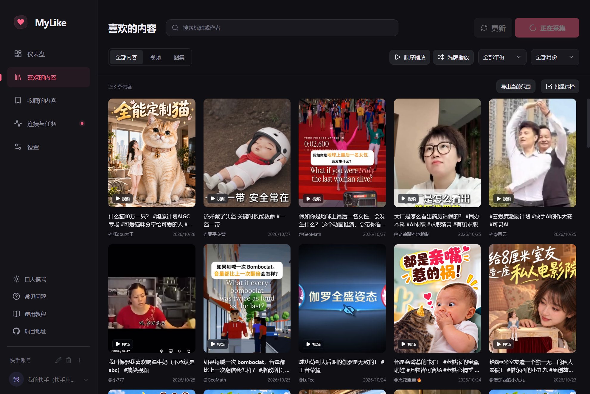

# MyLike · 快手版

把快手「赞过」整理、搜索、回看的 Windows 桌面应用 —— 界面与交互复刻自
[MyLike（抖音版）](https://github.com/Hannah2227/douyin-favorite-MyLike)。

**当前阶段：已接通真实快手账号，可以扫码登录、采集「赞过」、本地回看。**
收藏夹与取消点赞还没接，目前是只读版本。



## 现在能做什么

- **真实登录**：打开 kuaishou.com 窗口，用手机扫码；登录态按账号隔离保存
- **真实采集**：读取「赞过」列表，分页入库，支持断点续采
- **本地回看**：搜索、视频/图集筛选、年份月份筛选、虚拟滚动、批量选择
- **播放器**：顺序/洗牌、上一条/下一条、断点续播、倍速、音量、连播、清屏、全屏
- **本地库**：SQLite、多账号、深浅主题、导入导出、数据面板

实测：一个账号采集到 351 条赞过作品，封面与视频均来自快手 CDN，播放正常。

## 运行

```powershell
npm install
npm run dev          # 开发模式（Electron + 热更新）
npm run web          # 只跑浏览器预览（演示数据，http://127.0.0.1:5178）
npm run package:win  # 打包
```

开发时如果只想看界面、不连快手：`MYLIKE_ENGINE=demo npm run dev`。

> 受限环境提示：如果所在环境禁止子进程管道，`npm run dev` 会失败，
> 可改用 `node tools/build.cjs` 构建后直接运行 Electron。

## 它是怎么读到数据的

快手网页版把列表接口迁到了带签名的 REST 端点，签名由页面自己的 JS 生成。
应用的做法是：

1. 打开真实 kuaishou.com 窗口，用户扫码登录（不接触密码）
2. 用一个 preload 脚本捕获页面内置的签名环境（`$encode`）
3. 在页面里用这套环境签名，调用 `POST /rest/v/feed/liked`
4. 把返回的 `feeds[].photo` 转成应用的作品结构，写入本地 SQLite

不逆向算法、不保存账号密码，也不模拟客户端协议。

## 目录结构

```
src/
  main/                 Electron 主进程
    kuaishou/
      web-engine.ts     真实引擎：登录窗口、签名、拉取赞过
      engine.ts         演示引擎（MYLIKE_ENGINE=demo）
      parse.ts          响应解析（作品/收藏夹/媒体地址）
    storage/            SQLite（独立 worker）、队列、收藏夹、取消点赞
    application.ts      命令分发、账号、任务、播放
  preload/
    index.ts            界面桥接（window.mylike）
    ks.ts               快手窗口的签名环境捕获
  renderer/             界面（React 19 + TypeScript）
  shared/               类型契约、演示数据集
tools/                  构建/截图/端到端脚本（非产品代码）
```

## 已知限制

- 只接入了「赞过」；收藏夹、取消点赞还是演示实现
- 昵称暂时显示为「快手用户」（登录接口没返回昵称）
- 采集速度刻意放慢；过快可能被限流（返回错误码 2），暂停后过一会儿再继续
- 「项目地址」「检查更新」仍指向上游仓库

## 隐私

- 登录态（Cookie）、采集到的作品和播放记录**只保存在本机**，不会上传到任何服务器。
- 应用不收集设备信息，没有遥测，也不需要注册账号。
- 数据目录：`%APPDATA%\MyLikeKuaishou`（可在设置里打开）。

## 免责声明

本项目仅用于个人学习与整理本人账号内容，与快手科技无关联、未获授权或背书。
请勿用于商业用途、大规模采集或传播他人内容；自动化访问可能触发平台风控，
存在限流或账号受限的风险。

完整条款见 [DISCLAIMER.md](DISCLAIMER.md)，授权见 [LICENSE](LICENSE)，
上游项目的版权与许可见 [NOTICE.md](NOTICE.md)。
